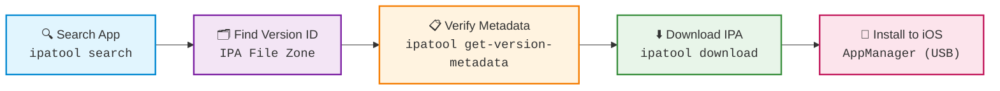

<div align="center">

# 📦 IPA Archive

**The open-source research hub and definitive guide for discovering, retrieving, and deploying historical iOS application packages (`.ipa`).**

[](https://creativecommons.org/licenses/by/4.0/)
[](#supported-environments)
[](https://github.com/majd/ipatool)
[](https://git.kawaiizenbo.me/kawaiizenbo/AppManager)
[](https://ipafilezone.st/)

[📖 Quick Start](#-quick-reference) • [📥 Download Older Versions](guides/downloading-older-versions.md) • [📲 Device Installation](guides/installing-downloaded-ipas.md) • [🛠️ Useful Tools](tools/useful-tools.md) • [🚨 Troubleshooting](troubleshooting/ipatool-errors.md)

[🪟 Windows Setup](guides/windows-setup.md) • [🍎 macOS Setup](guides/macos-setup.md) • [🐧 Linux Setup](guides/linux-setup.md)

---

</div>

## 🌟 Overview

**IPA Archive** is an open-source research and documentation project dedicated to exploring the Apple App Store distribution architecture. It documents modern, reliable methods for identifying historical app releases, resolving Apple's internal `externalVersionIdentifier` build numbers, downloading authentic signed packages via [`ipatool`](https://github.com/majd/ipatool), and deploying them to iOS test hardware using tools like [`AppManager`](https://git.kawaiizenbo.me/kawaiizenbo/AppManager).

> [!NOTE]
> This project builds upon foundational community research (such as [qnblackcat's Gist](https://gist.github.com/qnblackcat/4f7b77f685ccda2ff4ef916a27d66107)), modernizing the documentation with direct GUI deployment, updated CLI syntax, and comprehensive troubleshooting for Windows, macOS, and Linux users.

---

## 🧭 Visual Workflow



---

## ⚡ Quick Reference

```powershell
# 1. Authenticate with the App Store
ipatool.exe auth login --email your-apple-id@example.com

# 2. Search for the app to find bundleID and App ID
ipatool.exe search "Snapchat"

# 3. Ensure your account owns a license (for free apps)
ipatool.exe purchase -b com.toyopagroup.picaboo

# 4. Verify external version ID metadata (obtained from IPA File Zone)
ipatool.exe get-version-metadata -b com.toyopagroup.picaboo --external-version-id 885041606 --format json

# 5. Download the authentic signed IPA package
ipatool.exe download -b com.toyopagroup.picaboo --external-version-id 885041606

# 6. Deploy to paired device over USB via AppManager GUI
# Open AppManager -> Click "Install new" -> Select downloaded .ipa -> Success!
```

---

## 📚 Documentation Index

### 🚀 Core Walkthroughs
* [**Downloading Older Versions of iOS Apps Using ipatool**](guides/downloading-older-versions.md)  
  *The complete step-by-step walkthrough: login, licensing, version selection, download, and USB deployment.*
* [**Finding Build Identifiers (IPA File Zone Guide)**](guides/finding-build-identifiers.md)  
  *How to quickly locate exact App Store version IDs (`externalVersionIdentifier`) on [IPA File Zone](https://ipafilezone.st/).*
* [**Installing Downloaded IPAs on iOS (AppManager & CLI)**](guides/installing-downloaded-ipas.md)  
  *Deploying packages to iOS hardware over USB via [AppManager](https://git.kawaiizenbo.me/kawaiizenbo/AppManager) without jailbreak or 7-day expiration.*

### 💻 Quick OS Setup Guides
* [**🪟 Windows Setup Guide**](guides/windows-setup.md) — *PowerShell setup, Apple USB drivers, and AppManager installation.*
* [**🍎 macOS Setup Guide**](guides/macos-setup.md) — *Homebrew installation, native Keychain integration, and Apple Configurator.*
* [**🐧 Linux Setup Guide**](guides/linux-setup.md) — *Precompiled binaries, `usbmuxd`, and `libimobiledevice` configuration.*

### 🚨 Troubleshooting & Reference
* [**ipatool Common Errors & Solutions**](troubleshooting/ipatool-errors.md)  
  *Direct solutions for keystore prompts, `license is required`, Unicode dashes, launch crashes, and tvOS.*
* [**Recommended Tools & Resources**](tools/useful-tools.md)  
  *Curated collection of official repos, GUI frontends, and version databases.*

---

## 💡 Important Requirements & FairPlay DRM

> [!IMPORTANT]
> **Account Parity Requirement**:
> Because packages downloaded via `ipatool` are legitimate App Store binaries encrypted with Apple's FairPlay DRM:
> 1. The target iOS device **must be signed into the same Apple ID** used during `ipatool auth login`.
> 2. No jailbreak or AppSync is needed on stock devices as long as account parity is maintained.
> 3. These official packages **do not expire after 7 days** (unlike free developer certificate sideloading).

> [!WARNING]
> **Paid Applications**:
> `ipatool purchase` is strictly for acquiring free licenses ($0.00). It cannot bypass payment systems. For paid applications, you must legitimately purchase the app in the App Store on an iOS device first.

---

## 🤝 Contributing

Contributions from the community are warmly welcomed! Please read [CONTRIBUTING.md](CONTRIBUTING.md) for details on submitting bug reports, documentation updates, and research findings.

---

## ⚖️ License & Disclaimer

- **Documentation**: Licensed under the [Creative Commons Attribution 4.0 International (CC BY 4.0)](LICENSE).
- **Scripts**: Licensed under the MIT License.
- **Disclaimer**: This repository is strictly for research, digital preservation, and educational purposes. It does not host, distribute, crack, or circumvent copyright protection for any proprietary software. Users interact directly with Apple's servers using their own accounts.
