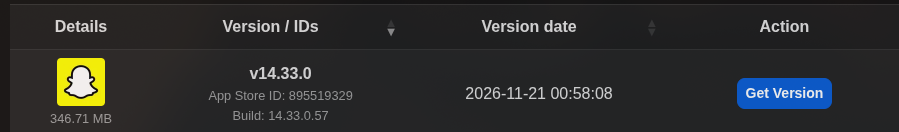

# Downloading Older Versions of iOS Apps Using ipatool

[🏠 Home](../README.md) • [📚 Guides Index](../README.md#-documentation-index) • [🚨 Troubleshooting](../troubleshooting/ipatool-errors.md) • [📲 Installation Guide](installing-downloaded-ipas.md)

---

## Overview

When an app update removes a critical feature, alters the user interface, or introduces compatibility bugs with your iOS version, you may need to acquire a previous release.

This guide provides a comprehensive, beginner-friendly walkthrough on how to discover, verify, and download older versions of iOS applications directly from Apple's servers using [`ipatool`](https://github.com/majd/ipatool), without resorting to untrusted third-party repackaged binaries.

> [!NOTE]
> This guide updates and expands upon classic community methods (such as [qnblackcat's Gist](https://gist.github.com/qnblackcat/4f7b77f685ccda2ff4ef916a27d66107)) by incorporating direct command-line metadata queries and modern deployment via [AppManager](https://git.kawaiizenbo.me/kawaiizenbo/AppManager).
> 
> **Need help setting up your OS first?**  
> See the dedicated guides: [🪟 Windows Setup](windows-setup.md) • [🍎 macOS Setup](macos-setup.md) • [🐧 Linux Setup](linux-setup.md)

---

## Prerequisites

| Requirement | Description | Link |
| :--- | :--- | :--- |
| **`ipatool` CLI** | Precompiled executable for Windows, macOS, or Linux | [Download ipatool Releases](https://github.com/majd/ipatool/releases) |
| **Apple Account** | Any valid Apple ID (does **not** need to be an `@icloud.com` email) | [Apple ID Portal](https://appleid.apple.com/) |
| **Version Database** | Web index to look up build identifiers | [IPA File Zone](https://ipafilezone.st/) |
| **Device Installer** | Open-source USB deployment utility | [AppManager Releases](https://git.kawaiizenbo.me/kawaiizenbo/AppManager/releases) |

---

## Step 1: Authenticate with the App Store

Open your terminal or Windows PowerShell, navigate to the folder where you placed `ipatool`, and log in:

```powershell
.\ipatool.exe auth login --email your-apple-id@example.com
```

> [!WARNING]
> **Check your syntax!**  
> Ensure you type standard ASCII double hyphens (`--email`). Copying from formatted web pages can introduce Unicode em-dashes (`—email`), resulting in `unknown shorthand flag: 'â'` errors. See [Troubleshooting: Unicode Dash Parsing](../troubleshooting/ipatool-errors.md#3-typographic--unicode-dash-parsing-error).

1. **Password**: Enter your Apple ID password when prompted.
2. **2FA Code**: Enter the 6-digit verification code displayed on your trusted Apple devices.
3. **Windows Passphrase Prompt**:
   ```text
   enter passphrase to unlock "C:\Users\<user>\.ipatool" (this is separate from your Apple ID password):
   ```
   > [!TIP]
   > On Windows, `ipatool` requests a local encryption passphrase to protect cached tokens on your machine. **This is not your Apple ID password.** Choose any secure passphrase you can remember for future commands. For more details, see [Troubleshooting: Windows Keystore Passphrase](../troubleshooting/ipatool-errors.md#1-windows-keystore-passphrase-confusion).

---

## Step 2: Search for the Target App & Acquire a License

Before Apple's Storefront allows downloading or querying version history, your Apple account must possess a license record for the app.

### 1. Search by Name
```powershell
.\ipatool.exe search "Snapchat"
```

Sample output:
```json
apps=[{
  "bundleID": "com.toyopagroup.picaboo",
  "id": 447188370,
  "name": "Snapchat: Chat with friends",
  "price": 0,
  "version": "14.33.0.57"
}]
```

Take note of the **`bundleID`** (`com.toyopagroup.picaboo`) and the store numeric **`id`** (`447188370`).

### 2. Obtain a Free License
If you haven't previously installed or "purchased" this app with this Apple ID, run:

```powershell
.\ipatool.exe purchase -b com.toyopagroup.picaboo
```

> [!IMPORTANT]
> The `purchase` command only works for **free applications** ($0.00). If the app is paid, you must purchase it legitimately in the App Store on an iOS device first. `ipatool` cannot bypass billing.

---

## Step 3: Find the Target Version Identifier

Apple does not track releases by their semantic string (`13.90.0`), but by an internal 64-bit number called the `externalVersionIdentifier` (e.g., `885041606`).

### Manual Web Lookup (Recommended)

> [!TIP]
> **Manual Search Recommended**:  
> Avoid relying on direct links or automated scrapers to app pages, as they frequently fail or return fetch errors due to bot protection and session tokens. Instead, search manually in your browser:

1. Open your web browser and go to the homepage: **[IPA File Zone](https://ipafilezone.st/)**.
2. Use the search bar on the website to search for the app manually by name (e.g., `Snapchat`) or paste the numeric App ID (`447188370`).
3. Open the app from the search results and scroll down to the **Version History** section.
4. Manually locate the row for your target version (such as `v14.33.0` or `v13.90.0`).
5. In the **Version / IDs** column, look for the line labeled **"App Store ID:"** (for example: `App Store ID: 895519329`). This number is the `externalVersionIdentifier` needed for `ipatool`. Copy this numeric ID.


*Figure: Locating the App Store ID (externalVersionIdentifier) under Version / IDs on IPA File Zone.*

### Alternative: Native CLI Manual Discovery
If the web database is unreachable, you can find the ID manually using `ipatool`:
1. List all historical version IDs:
   ```powershell
   .\ipatool.exe list-versions -b com.toyopagroup.picaboo --format json
   ```
2. Check candidate IDs towards the end of the array (newer releases have higher numbers) using:
   ```powershell
   .\ipatool.exe get-version-metadata -b com.toyopagroup.picaboo --external-version-id <candidate-id> --format json
   ```

*(For a deeper comparison of manual discovery techniques, read [Finding Build Identifiers](finding-build-identifiers.md).)*

---

## Step 4: Verify Metadata with ipatool

Confirm that the identifier maps to the correct marketing release directly from Apple's API:

```powershell
.\ipatool.exe get-version-metadata -b com.toyopagroup.picaboo --external-version-id 885041606 --format json
```

Expected response:
```json
{
  "level": "info",
  "externalVersionID": "885041606",
  "displayVersion": "13.90.0",
  "releaseDate": "2026-04-28T19:28:24Z",
  "success": true
}
```

Once `"displayVersion"` matches what you want, proceed to download.

---

## Step 5: Download the Package (.ipa)

Execute the download command supplying both the bundle ID and the verified external version ID:

```powershell
.\ipatool.exe download -b com.toyopagroup.picaboo --external-version-id 885041606
```

Output:
```text
INF output="com.toyopagroup.picaboo_447188370_13.90.0.ipa" purchased=false success=true
```

The decrypted package is now saved in your active working directory.

---

## Step 6: Deploy to Your iOS Device

Because the downloaded package is signed with Apple's FairPlay DRM for your Apple ID, installing it does **not require a jailbreak or a paid developer account**.

1. Connect your iPhone or iPad to your PC via USB.
2. Tap **Trust This Computer** on the device.
3. Launch **[AppManager](https://git.kawaiizenbo.me/kawaiizenbo/AppManager)**.
4. Click **Install new**, select your `.ipa` file, and wait for `Process ended with code 0 (Success)`.

> [!IMPORTANT]
> The target iOS device **must be signed into the same Apple ID** used with `ipatool` (under **Settings > App Store**). If there is an account mismatch, the app will instantly close on launch.

For comprehensive installation instructions, read [Installing Downloaded IPAs](installing-downloaded-ipas.md).

---

[⬅️ Windows Setup](windows-setup.md) • [Finding Build Identifiers ➡️](finding-build-identifiers.md)
