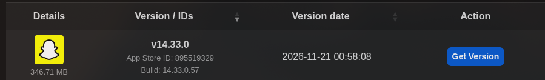

# Finding Build Identifiers with IPA File Zone & Metadata

[🏠 Home](../README.md) • [📚 Guides Index](../README.md#-documentation-index) • [📥 Download Older Versions](downloading-older-versions.md) • [🐍 Verification Script](../scripts/find_version_id.py)

---

## Overview

When targeting an older version of an iOS application, the primary challenge is mapping human-readable version strings (e.g. `13.90.0`) to Apple's internal 64-bit integer index: the `externalVersionIdentifier` (e.g. `885041606`).

This guide explains how to look up, verify, and automate external version identifier discovery using web databases such as [IPA File Zone](https://ipafilezone.st/) and [`ipatool`](https://github.com/majd/ipatool).

---

## The Raw Identifier Problem

When requesting version history directly via the CLI:

```powershell
ipatool.exe list-versions -b com.toyopagroup.picaboo --format json
```

Apple's Storefront returns a flat JSON array containing hundreds or thousands of unmapped integers:

```json
["3880712", "3933851", "3954343", ..., "884513024", "885041606", "895519329"]
```

Querying every single integer using `ipatool get-version-metadata` takes hundreds of HTTP requests and can easily trigger Storefront rate limiting. Web databases solve this by indexing historical metadata in advance.

---

## Method 1: Manual Lookup on IPA File Zone (Recommended)

[**IPA File Zone**](https://ipafilezone.st/) is a community-driven web catalog indexing App Store releases and mapping them directly to Apple's external version IDs.

> [!TIP]
> **Why Manual Search is Best**:  
> Deep-linking directly to app pages or using automated HTTP scrapers often returns fetch or timeout errors due to Cloudflare anti-bot verification and dynamic session parameters. It is strongly recommended to navigate to the site manually in a standard browser.

### 1. Manual Search Workflow
1. In your browser, open the homepage: **[https://ipafilezone.st/](https://ipafilezone.st/)**.
2. In the site's search bar, enter the app name (e.g. `Snapchat`) or its numeric App Store ID (`447188370`).
3. Click on the application from the search results to open its catalog page.

### 2. Inspect the Version History Table
Scroll down to the **Version History** section. The table displays entries structured as follows:



| Details | Version / IDs | Version Date | Action |
| :--- | :--- | :--- | :--- |
| 🟡 **Icon**<br/>346.71 MB | **v14.33.0**<br/>**App Store ID**: `895519329`<br/>Build: 14.33.0.57 | 2026-11-21 00:58:08 | `Get Version` |
| 🟡 **Icon**<br/>312.45 MB | **v13.90.0**<br/>**App Store ID**: `885041606`<br/>Build: 13.90.0.42 | 2026-04-28 19:28:24 | `Get Version` |

> [!IMPORTANT]
> **Understanding the "App Store ID" Label**:  
> In the IPA File Zone interface under the **"Version / IDs"** column, the number labeled **"App Store ID:"** (e.g., `895519329` or `885041606`) is the exact **`externalVersionIdentifier`** needed for `ipatool`. Do not confuse this with the main application item ID (`447188370`).

### 3. Copy the Identifier
Manually copy the numeric value listed under **App Store ID:** (e.g., `885041606`) to use with `ipatool`.

---

## Method 2: Verify with ipatool Metadata API

Before initiating a multi-gigabyte package download, verify the external version ID against Apple's live API to ensure it corresponds to the desired marketing version:

```powershell
ipatool.exe get-version-metadata -b com.toyopagroup.picaboo --external-version-id 885041606 --format json
```

Response:
```json
{
  "level": "info",
  "externalVersionID": "885041606",
  "displayVersion": "13.90.0",
  "releaseDate": "2026-04-28T19:28:24Z",
  "success": true,
  "time": "2026-11-24T14:07:10+05:30"
}
```

> [!TIP]
> Notice the `"displayVersion"` field: `13.90.0`. This confirms with 100% certainty that downloading ID `885041606` will yield the exact release required.

---

## Method 3: Automated Verification via Python

We provide a standalone helper script, [`scripts/find_version_id.py`](../scripts/find_version_id.py), to automate verification:

```bash
# Verify a single candidate ID
python3 scripts/find_version_id.py -b com.toyopagroup.picaboo --id 885041606
```

Output:
```text
[*] Querying metadata for bundle: com.toyopagroup.picaboo, version ID: 885041606...
[+] Found Match:
    Display Version: 13.90.0
    External ID:     885041606
    Release Date:    2026-04-28T19:28:24Z
```

---

## Alternative Version Databases

- **[armconverter.com](https://armconverter.com/decryptedappstore)**: Useful database for finding bundle identifiers, minimum iOS versions, and build signatures.
- **Lancely App Store Query**: Web lookup tool for tracking historical pricing, storefront IDs, and version build identifiers.

---

[⬅️ Downloading Older Versions](downloading-older-versions.md) • [Installing Downloaded IPAs ➡️](installing-downloaded-ipas.md)
