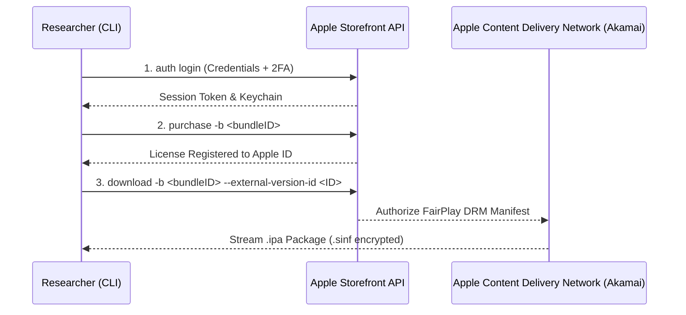

# Getting Started with Package Retrieval

[🏠 Home](../README.md) • [📚 Guides Index](../README.md#-documentation-index) • [📥 Flagship Guide: Downloading Older Versions](downloading-older-versions.md)

---

## Overview

This guide explains the foundational mechanisms behind Apple's App Store distribution, account licensing, and how command-line utilities like [`ipatool`](https://github.com/majd/ipatool) interact with Apple's Storefront APIs.

---

## Architecture of App Store Package Delivery

When a user requests an application from an iOS device, Apple's Storefront checks three conditions:
1. **Account Authentication**: Verification that the request is signed with a valid `DSID` (Directory Services Identifier) session token.
2. **License Receipt (`buyProduct`)**: Verification that the Apple account has a purchase record for the target application (even for free apps).
3. **Storefront & Region**: Verification that the application is licensed and active in the user's regional storefront (e.g. US, UK, India).

---

## Command Quick Reference

| Command | Action | Example |
| :--- | :--- | :--- |
| `ipatool auth login` | Authenticate with credentials and 2FA | `ipatool auth login --email user@example.com` |
| `ipatool search` | Search for applications by name | `ipatool search "WhatsApp"` |
| `ipatool purchase` | Claim a free application license | `ipatool purchase -b net.whatsapp.WhatsApp` |
| `ipatool list-versions` | Enumerate all historical version IDs | `ipatool list-versions -b net.whatsapp.WhatsApp` |
| `ipatool get-version-metadata` | Query metadata for a specific build ID | `ipatool get-version-metadata -b <bundleID> --external-version-id <ID>` |
| `ipatool download` | Fetch the `.ipa` binary package | `ipatool download -b <bundleID> --external-version-id <ID>` |

---

## Next Steps

- Proceed to the flagship guide: [**Downloading Older Versions of iOS Apps Using ipatool**](downloading-older-versions.md).
- Learn how to look up version IDs quickly on [**IPA File Zone**](finding-build-identifiers.md).
- Learn how to install retrieved packages via [**AppManager**](installing-downloaded-ipas.md).

---

[⬅️ Home](../README.md) • [Downloading Older Versions ➡️](downloading-older-versions.md)
