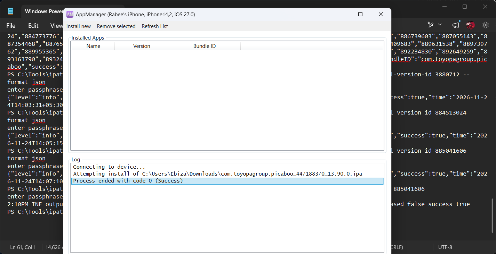

# Installing Downloaded IPAs via AppManager & CLI

[🏠 Home](../README.md) • [📚 Guides Index](../README.md#-documentation-index) • [📥 Download Older Versions](downloading-older-versions.md) • [🛠️ Tools Matrix](../tools/useful-tools.md)

---

## Overview

Packages retrieved from the App Store using [`ipatool`](https://github.com/majd/ipatool) are official, uncracked applications signed with Apple's FairPlay Digital Rights Management (DRM) for your Apple ID.

Because these packages are signed by Apple, they **do not require jailbreaking, enterprise certificates, or 7-day sideload renewals**. This guide details how to install them over USB using [**AppManager**](https://git.kawaiizenbo.me/kawaiizenbo/AppManager) or command-line tools.

---

## Method 1: AppManager (Recommended for Windows)

[**AppManager**](https://git.kawaiizenbo.me/kawaiizenbo/AppManager) is an open-source Windows graphical user interface for `ideviceinstaller` created by [kawaiizenbo](https://git.kawaiizenbo.me/kawaiizenbo).

- **Project Repository**: [kawaiizenbo/AppManager](https://git.kawaiizenbo.me/kawaiizenbo/AppManager)
- **Direct Downloads**: [AppManager Releases on Gitea](https://git.kawaiizenbo.me/kawaiizenbo/AppManager/releases)

---

### Prerequisites & System Requirements

| Requirement | Specification | Notes |
| :--- | :--- | :--- |
| **Operating System** | Windows 7, 8.1, 10, 11 (64-bit) | Compatible with PowerShell 5.1/7+ |
| **Runtime** | .NET Framework 4.5 or newer | Built into Windows 10/11 |
| **USB Drivers** | Apple Mobile Device Support | Provided by iTunes or Apple Devices app |
| **iOS Version** | iOS 2.0 through iOS 17/18+ | Stock or jailbroken devices |

---

### Step-by-Step Installation

#### 1. Download & Launch AppManager
1. Visit the [AppManager Releases Page](https://git.kawaiizenbo.me/kawaiizenbo/AppManager/releases).
2. Download `AppManager v1.1 Setup.exe` or extract the portable `AppManager-v1.1.zip`.
3. Launch `AppManager.exe`.

#### 2. Connect Your Device Over USB
1. Plug your iPhone/iPad into your PC using a certified USB cable.
2. Unlock your iOS screen.
3. When the alert **"Trust This Computer?"** appears, tap **Trust** and enter your passcode.
4. AppManager will immediately detect your device and display its details in the title bar:
   ```text
   AppManager (Rabee's iPhone, iPhone14,2, iOS 17.x)
   ```

#### 3. Deploy the IPA File
1. Click the **Install new** button in the top toolbar.
2. Select the `.ipa` package downloaded with `ipatool` (e.g. `com.toyopagroup.picaboo_447188370_13.90.0.ipa`).
3. Monitor the live log in the bottom panel:
   ```text
   Connecting to device...
   Attempting install of C:\Users\Ebiza\Downloads\com.toyopagroup.picaboo_447188370_13.90.0.ipa
   Process ended with code 0 (Success)
   ```
4. Once `Process ended with code 0 (Success)` is printed, the app icon appears immediately on your iOS Home Screen.


*Figure: Successful package installation using AppManager over USB on Windows without jailbreak.*

---

## 🔒 Critical FairPlay DRM Rule: Account Parity

> [!IMPORTANT]
> **Why did my installed app flash and close immediately on open?**  
> Apple packages downloaded via `ipatool` contain an encrypted FairPlay signature receipt (`SC_Info/`) matching the Apple ID used to download it.
> 
> - **The Rule**: The target iPhone or iPad **must be signed into the same Apple ID** used during `ipatool auth login` (under **Settings > App Store** or primary iCloud).
> - Once the device account matches, iOS decrypts and executes the binary normally.
> - **No 7-Day Sideload Expiration**: Unlike free developer sideloading (AltStore/Sideloadly), these are permanent App Store purchase receipts. They will never expire after 7 days.

---

## Method 2: Command-Line Installation via ideviceinstaller

Cross-platform users (Linux, macOS, and Windows CLI) can deploy packages using `ideviceinstaller` from the [libimobiledevice](https://libimobiledevice.org/) suite:

```bash
# Verify device communication
idevice_id -l

# Deploy the package
ideviceinstaller -i /path/to/downloaded-app.ipa
```

---

## Method 3: macOS Apple Configurator

On macOS:
1. Connect your iOS device via USB.
2. Open **[Apple Configurator](https://apps.apple.com/us/app/apple-configurator/id1037126344)**.
3. Drag and drop the downloaded `.ipa` package directly onto your device card to install.

---

[⬅️ Finding Build Identifiers](finding-build-identifiers.md) • [ipatool Troubleshooting ➡️](../troubleshooting/ipatool-errors.md)
